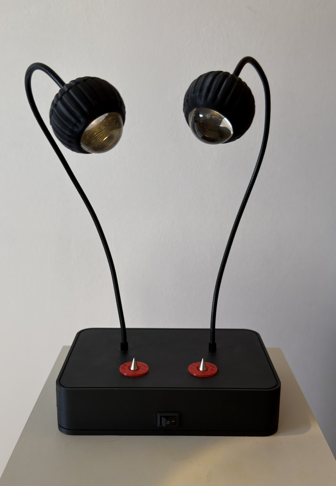

# LedBulbLampNano

Arduino sketch for a two-light LED desk lamp with touch controls, several animated lighting modes and settings that survive a power cycle.

  
  

## Hardware

- **Board:** Arduino Nano clone with an **LGT8F328P**. Install the *lgt8fx* board package and select it in the Arduino IDE with the **32 MHz internal clock**.
- **LEDs:** two channels, PWM-driven on pins **6** and **9**.
- **Touch buttons:** **DIM** on pin **4** and **MODE** on pin **2** (HIGH when touched).

## Controls

| Button | Short press | Long press (1 s) |
|---|---|---|
| **DIM** | Step through 5 brightness levels | Dim smoothly up and down; let go to stop |
| **MODE** | Next lighting mode (also leaves AUTO) | AUTO mode: cycles through all modes every 30 s, confirmed by three flashes |

## Lighting modes

1. **Stacked fade:** each LED fades in and out in turn
2. **Wave flow:** both LEDs follow an offset sine wave
3. **Flip flop:** the LEDs swap between a quick rise and a slow fade
4. **Static:** steady light
5. **Heartbeat:** a double-pulse heartbeat
6. **Candle:** independent, flickering flames

## Saved settings

The selected mode (or AUTO) and brightness level are stored in EEPROM and restored at power-up. A setting is written only after it has stayed unchanged for 10 seconds, which limits EEPROM wear.
